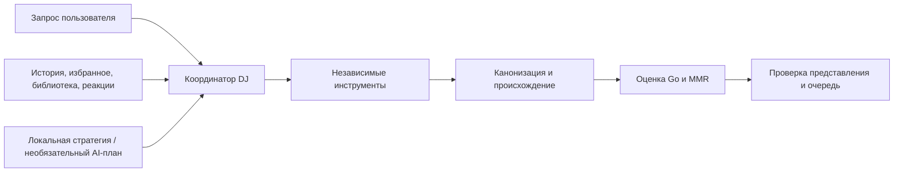

# Переработка персонального DJ

- [x] Проследить историю, избранное, поведение, профиль, каналы, LLM, кэш и очередь.
- [x] Обеспечить работу координатора без LLM и при её ошибке/лимите.
- [x] Отделить стратегическое планирование от локального ранжирования, кэшировать план.
- [x] Расширить профиль и сбор поведения, разделить долгий вкус и сессию.
- [x] Разделить каноническую запись, кандидата и воспроизводимую версию; сохранить происхождение.
- [x] Независимые каналы, ограничение ожидания и частичные результаты.
- [x] Прозрачная оценка в Go и MMR; seed и feedback влияют на итог.
- [x] Ограничить давность повторов; различать старую коллекцию и новый результат.
- [x] Проверить интегрированный путь, отказ модели/источника, два радио и обновление профиля.
- [x] Windows и frontend собираются локально.
- [x] Релизная Android-сборка и проверка прежней подписи в CI: run 46117013401.
- [x] Технический отчёт с ограничениями.
- [ ] Проверка установленного релиза на физическом телефоне — ADB сейчас без устройств.

## Найденные реальные цепочки

История: audioEngine → addHistory → API/Wails AddHistory → Store.HistoryAdd → history. Это событие запуска, не доказательство дослушивания. HistoryList возвращает отдельные события; buildTaste читал лишь 120 и окно 90 дней. Избранное: FavoriteList/FavoriteSet в sqlite, синхронизируемое избранное сервисов попадает туда же. Плейлисты и localFn также входят в buildTaste. Поисковые запросы не считаются положительной оценкой.

Поведение: radioSession/playerStore/audioEngine → reportDJEvent → /intelligence/feedback → dj_feedback; раньше события без DJ-session молча терялись. saveDJReaction восстанавливает метаданные из dj_candidates и пишет последние 120 реакций. buildTaste добавляет djReactionWeights. SQLite SessionProfile содержит отдельные PlayedIDs/SuggestedIDs/revision, но не устойчивый полный вкус. Исторические данные не содержат фактически прослушанных миллисекунд: задним числом их нельзя выдумать.

Обычный режим: RelatedTracks/Recommendations/AutoMix используют собственные кэши, graph candidates и fallback. Weekly shuffle стабилен по неделе. DJ: /intelligence/radio или /collection → prepareDJ → TasteProfile → PlanSearch → steps → PrepareDJPool → Select LLM → SelectDJ → FinalizeDJ → djReady/intelligence.collection → frontend queue. В v0.2.40 ошибка PlanSearch прерывает работу, а отсутствие ключа исключает DJ из радио. LLM участвует дважды за итерацию; local weights всё ещё подчинены её per-track score. Suggestions хранятся без даты, отсекаются бессрочно. Глобальный failedRevision блокирует последующие задачи. Это системные причины, не проблема ещё одного промпта.

Канонизация: identity.GroupTracks/RankCandidates, версии live/remix/acoustic/remaster; PrepareDJPool выбирает playable representation. Метаданные ищутся через SameRecording; это идентификация, не релевантность. DiscoveryCandidatesFor → similarArtistsCached (Last.fm/Deezer) → topTracksCached → resolveDJMetadata. Источники фактически реализуют похожие треки Яндекса/Last.fm и граф артистов Deezer; Spotify не предоставляет здесь выдуманный recommendation API.

Плеер: useRadioAutoplay → djRadio → готовый session result → queue, djPlanId сохраняется для событий; при выключенном DJ клиент вызывает listRelatedTracks. Android native queue использует существующий backend. Повторная коллекция уже имеет jobId/resultId: интерфейс показывает предыдущую коллекцию при несовпадении jobId. Новые изменения сохраняют это различие.

## Реализованный путь

Основной код: `internal/core/dj_coordinator.go`. `prepareDJ` управляет фоновой задачей, сохранением и передачей результата; `coordinateDJ` выбирает инструменты, собирает пул и вызывает **единственный локальный музыкальный отбор** `RankDJCandidates`. Здесь нет предварительного AutoMix и нет вызова `Director.Select`. Старые Select/SelectDJ сохранены для совместимости старого API/тестов, но новая очередь через них не проходит. Выключенный DJ по-прежнему использует прежнее RelatedTracks; включённый DJ работает и без ключа. Незавершённый DJ не подменяется обычным радио под его названием.

### Профиль и события

DJ строит долгий профиль из максимум 10 000 записей истории за 730 дней, избранного, первых 20 пользовательских плейлистов, локальной библиотеки и сохранённой обратной связи. В экспортируемом профиле до 100 взвешенных артистов; в запрос модели отправляются первые 20. Нормализация сохраняет градации силы предпочтения и уверенности. Профиль пересчитывается при подготовке и через кнопку в настройках (`GET /v1/intelligence/profile`); перезапуск приложения не нужен. Первые 12 положительных примеров — компактный контекст для планирования, а не весь источник персонализации.

Реакции обычного воспроизведения теперь поступают в `/behavior`, реакции DJ — в существующий `/feedback`. На устройстве сохраняются последние 2000 реакций с метаданными, повторная доставка ID не применяется дважды. На Android нативный сервис отправляет эти события и без активного WebView. Время прослушивания оценивается по наблюдаемому продвижению позиции: перемотки, паузы и большие разрывы опроса не засчитываются как услышанная музыка. Это консервативная оценка, а не точное измерение услышанных ухом секунд.

Начальные веса: лайк +3, дизлайк −3, повтор +1.5, дослушивание +0.4 при доле >=80%; полураспад 30 дней. Одиночный пропуск, запуск и техническая ошибка не дают отрицательного веса. Пропуск остаётся фактом текущей сессии. Отдельное явное «не рекомендовать» использует существующие устойчивые блокировки, а снятый запрет не восстанавливается из старой поведенческой реакции.

Сессионная оценка берёт положительные реакции за последние два часа отдельно от долгого вкуса. Проигранные ID текущей сессии исключаются, недавняя история и последние предложения за 24 часа дают штраф; старые недатированные бессрочные exclusions больше не используются. Журнал предложений ограничен 200 элементами. В режиме по треку исходная композиция весит минимум 70%; известное стилевое противоречие по метаданным не компенсируется глобальным любимым артистом.

### Инструменты и идентичность

Используются существующие SimilarTracks Яндекса/Last.fm, соседи избранных и часто слушаемых записей, граф артистов Last.fm/Deezer, каталог и библиотека. Каталог разрешает реальную запись; само совпадение поисковой строки не добавляет музыкальную релевантность. Для DJ граф обходит до трёх предпочтительных артистов и двух соседей каждого, выдавая разрешённые частичные результаты без ожидания всех старых двухшаговых/теговых запросов. Обычный Discovery сохранён.

Одна задача делает максимум два раунда приобретения кандидатов, до 80 записей в общем пуле. Инструменты работают параллельно: 7 секунд на инструмент, 8 на пакет. Когда быстрые каналы уже вернули достаточно связанных записей, после секунды дополнительного ожидания медленные запросы отменяются. Если локальный отбор оставил мало музыки, запускаются ещё не использованные инструменты, включая библиотеку; повторного модельного ранжирования нет. Восемь слотов ограничивают одновременно работающие верхние инструменты между задачами. Адаптер, игнорирующий context, нельзя принудительно уничтожить в Go; его поздний ответ не меняет завершённую очередь.

Якоря избранного меняются между задачами по всей доступной коллекции, исторические — среди 30 наиболее весомых записей. Это меняет поиск, а не просто перемешивает одинаковый итог. Порядок кандидатов не заменяет музыкальный отбор.

Существующий `identity.GroupTracks` отделяет каноническую запись и `PlaybackCandidate`, сохраняет live/remix/acoustic/remaster и учитывает длительность. DJ сохраняет canonical_id, service:id выбранной версии, все каналы и якоря/артистов происхождения. Копии одной записи объединяют происхождение до выбора сервиса. Идентичность эвристическая: нет акустического fingerprinting или доказательства совпадения аудио. Проверка до очереди подтверждает пригодную форму адаптера и действующие блокировки; доступность конкретного потока окончательно проверяет существующий playback resolver.

### Оценка и настройка

`internal/recommendations/dj_rank.go`: долгий вкус и жанровый cosine, артист, сессия, графовая связь с весом персонального якоря, новизна, качество метаданных, реакции, штраф повторов. Затем greedy MMR вычитает максимальную близость к уже выбранному множеству; не больше двух записей артиста. Финальная проверка не переставляет вычисленный MMR-порядок. У каталожного совпадения без музыкальных/персональных свидетельств нет автоматического допуска.

Начальные веса: taste .24, artist .18, session .12, graph .30, novelty .08, metadata .08, repeat .25, MMR .18. Это эвристики, не вероятность понравиться. Жанровые векторы — сходство метаданных, не анализ звучания. Причины и компоненты оценки сохраняются в кандидатах/плане, краткая причина выводится у трека.

Расширенная настройка: `GET /v1/intelligence/tuning` возвращает объекты ranking и behavior; POST принимает ту же структуру с изменениями, проверяет диапазоны и инвалидирует стратегию. У этих весов пока нет отдельной формы в интерфейсе. Кнопка пересчёта профиля есть в настройках DJ.

### Роль модели, промпт, токены и кэш

`internal/intelligence/providers/anyllm.go`, `plannerInstruction`: модель получает режим, seed, ограниченный профиль, текущие реакции и реально доступные каналы. Возвращает JSON со scope, числовой стратегией и 1–5 шагами поиска, суммарно до 40 кандидатов. Промпт запрещает выдумывать возможности и трактовать музыкальные метаданные как команды. Ответ строго проверяется; недопустимый ответ заменяется локальной стратегией. Модель не получает управление плеером и не назначает per-track оценки.

Не более одного запроса стратегии на задачу; deadline 20 секунд, максимум ответа 2500 токенов, ограничение входа 64 KiB и дневной лимит именно обращений к модели. На первом холодном запросе модель всё ещё может добавить до 20 секунд — мгновенную AI-стратегию это не гарантирует. На ошибке, отсутствии ключа и исчерпанном лимите работает локальный DJ. Ошибка модели не записывает глобальный запрет на будущие подборки.

Кэшируется план на 6 часов, не готовый плейлист; неудача модели — на 5 минут против повторного расхода. На диске 16 слотов с проверкой полного ключа; обычные изменения timestamp проигрывания не уничтожают кэш, значимые изменения вкуса, явные реакции, seed, режим, каналы и конфигурация — уничтожают. В каждом новом задании заново собираются кандидаты и считаются оценки. UI явно показывает сохранённую стратегию, фактическое число LLM-вызовов, старую коллекцию при новом незавершённом job и реальные ошибки каналов. Уже подготовленный радиосегмент живёт до 10 минут и проверяется перед выдачей.

## Проверка и границы результата

28.11.2026: Go-тесты, 113 frontend-тестов и production frontend прошли. Локальная Windows-сборка Wails создана. Проверены обе ветви радио, отсутствие ключа, плохой JSON модели, кэш стратегии и новый scope, сохранённый дневной лимит после рестарта, независимость быстрого канала, отмена медленного запроса, MMR, вес персонального якоря, длинная история, пересчёт после реакции и исключение перемотки из прослушанного времени.

На **копии** пользовательской SQLite выполнены сетевые прогоны обоих режимов без LLM и без изменения установленной очереди. Первоначальное ожидание всех каналов: ~7.1–7.2 с. После отмены ненужного ожидания: 1.2–1.8 с, по 12 треков; профиль 100 артистов, Infinite 24 кандидата, Track 12. Это реальные результаты адаптеров, но не слепая оценка музыкального качества пользователем. Копия базы и временный диагностический тест после прогона удалены. Платных модельных запросов не выполнялось.

В этих прогонах воспроизводимые версии были из Яндекса; Last.fm similar_tracks вернул ошибку, более медленный граф отменялся после достаточного результата. **Разные каналы поиска не гарантируют несколько сервисов в каждой очереди.** Нельзя честно обещать межсервисное разнообразие при недоступном каталоге или недостатке разрешённых версий. Для следующей качественной оценки нужны реакции на реальные новые треки, доля неизвестных артистов, повторы между сессиями и сравнение с обычным радио. Хороший JSON и количество треков сами по себе не доказывают хороший музыкальный вкус системы.

Новых CGO/Rust/Python/ML-зависимостей, внешнего сервера или векторной БД нет. Весь путь использует существующий Go/SQLite/backend и общий React-интерфейс. Локальная компиляция Kotlin не стартовала из-за `Unable to establish loopback connection` у Java; Android прошёл полноценную сборку в CI, проверка прежнего сертификата успешна. Физический телефон сейчас недоступен в ADB, это отдельный незакрытый пункт.

Релиз [v0.2.41](https://github.com/Enixq/cryon/releases/tag/v0.2.41) опубликован из коммита `552810a`. [CI 46117013401](https://github.com/Enixq/cryon/actions/runs/46117013401) завершён успешно: Windows EXE/NSIS, Android arm64, проверка прежнего сертификата. Опубликованы APK, EXE, установщик и NOTICE. Единственная незакрытая платформенная проверка — запуск на физическом телефоне; прежний Wi-Fi ADB-адрес отвергает соединение.
